<div align="center">

  <!-- HERO BANNER -->
  

  <br/>

  <!-- TYPING ANIMATION -->
  <a href="https://github.com/pablotome8">
    
  </a>

  <br/>

  <!-- PROFILE BADGES -->
  
  
  
  

</div>

<br/>

---

## ⚡ About Me

I'm **Pablo Tomé Manzano**, a **Web Application Development (DAW)** developer and **Data Analyst** passionate about building complete, data-driven web ecosystems—from responsive, modern interfaces to containerized backend workflows and analytical database architectures.

<table>
  <tr>
    <td width="56%" valign="top">
      <ul>
        <li>🌐 <b>Full-Stack Web Development:</b> Building web interfaces and server-side applications with <b>HTML5, CSS3, Tailwind CSS, JavaScript (ES6+), PHP 8, Node.js, and Java 21</b>, supported by modern build tooling (<b>Vite, pnpm, fnm, Composer, Maven</b>).</li>
        <li>📊 <b>Data Analysis & Database Design:</b> Modeling, querying, and analyzing relational and document datasets using <b>Python (<code>uv</code>), SQL, PostgreSQL 17, MongoDB, and DBeaver</b>.</li>
        <li>🐧 <b>Linux & Containerized Workflow:</b> Daily driver on <b>CachyOS (Arch Linux)</b> with a customized <b>Fish Shell + Starship</b> terminal environment, <b>Docker & Compose</b>, <b>Nginx</b>, <b>Lazygit / Lazydocker</b>, and <b>Bruno</b> for API testing.</li>
        <li>🌱 <b>Currently Learning:</b> Actively expanding my stack into <b>React</b>, <b>Express.js</b>, and <b>Laravel</b>.</li>
        <li>🏃‍♂️ <b>Beyond the Terminal:</b> Avid reader 📚 and sports enthusiast—bringing discipline, consistency, and continuous improvement to every project.</li>
      </ul>
    </td>
    <td width="44%" valign="top">

```yaml
developer:
  name: "Pablo Tomé Manzano"
  location: "Oviedo, Asturias, ES"
  environment: "CachyOS (Arch) • Fish • Starship"
  roles:
    - "Full-Stack Web Developer"
    - "Data Analyst"
  core_stack:
    web:     ["HTML5", "CSS3", "Tailwind", "JS (ES6+)", "PHP", "Node.js"]
    data_db: ["Python (uv)", "PostgreSQL 17", "MongoDB", "SQL", "DBeaver"]
    tooling: ["Vite", "pnpm", "fnm", "Composer", "Java 21", "Maven"]
    devops:  ["Docker", "Nginx", "Git & Lazygit", "Lazydocker", "Bruno"]
  currently_learning:
    - "React"
    - "Express.js"
    - "Laravel"
```

  </td>
  </tr>
</table>

---

## 🛠️ Tech Stack & Daily Environment

<div align="center">

  <a href="https://skillicons.dev">
    
  </a>

</div>

<br/>

<table width="100%">
  <tr>
    <th width="33%" align="center">🌐 Full-Stack Web & Tooling</th>
    <th width="33%" align="center">📊 Data Analysis & Databases</th>
    <th width="33%" align="center">🐧 Linux, DevOps & Workflow</th>
  </tr>
  <tr>
    <td align="center" valign="top">
      <br/>
      
      
      
      
      
      
      
      
      
      
      
      <br/><br/>
    </td>
    <td align="center" valign="top">
      <br/>
      
      
      
      
      
      
      
      <br/><br/>
    </td>
    <td align="center" valign="top">
      <br/>
      
      
      
      
      
      
      
      
      
      <br/><br/>
    </td>
  </tr>
  <tr>
    <td colspan="3" align="center">
      <br/>
      <b>🌱 Currently Learning &amp; Expanding Into</b>
      <br/><br/>
      
      &nbsp;
      
      &nbsp;
      
      <br/><br/>
    </td>
  </tr>
</table>

---

## 🚀 Featured Projects — Full-Stack & Data

<table width="100%">
  <tr>
    <td width="50%" valign="top">
      <h3>🎬 <a href="https://github.com/pablotome8/proyecto5-noSQL-movies-pabloTomeManzano">NoSQL Movies & Cinemas REST API</a></h3>
      <p>
        Backend RESTful API built with <b>Node.js, Express, and MongoDB (Mongoose)</b> to manage a movie catalog and cinema locations. Features complete CRUD operations, multi-criteria filtering (by genre, release year, title), relational document population (<code>ObjectId</code> + <code>populate</code>), and data seeding.
      </p>
      <p>
        
        
        
        
      </p>
    </td>
    <td width="50%" valign="top">
      <h3>✈️ <a href="https://github.com/pablotome8/proyecto4-SQL-airport-pabloTomeManzano">Airport SQL Data Analysis</a></h3>
      <p>
        Analytical querying and relational exploration over an aviation & booking database in <b>PostgreSQL / SQL</b>. Includes multi-table <code>JOIN</code> pipelines, booking revenue filtering, fleet utilization aggregations, multi-passenger reservation metrics, and departure delay interval analysis.
      </p>
      <p>
        
        
        
      </p>
    </td>
  </tr>
  <tr>
    <td width="50%" valign="top">
      <h3>🌸 <a href="https://github.com/pablotome8/FloristeriaLaBajo">Floristería Labajo — Web & Management Platform</a></h3>
      <p>
        End-to-end platform for organic flower e-commerce and internal administration. Unifies an intuitive customer web portal (<b>HTML5 & CSS3</b>) with a relational database architecture connected via <b>JDBC & SQL</b> in <b>Java</b> for order tracking, fresh stock control, and delivery logistics.
      </p>
      <p>
        
        
        
        
      </p>
    </td>
    <td width="50%" valign="top">
      <h3>📕 <a href="https://github.com/pablotome8/HorrorLibray">HorrorLibrary — Stephen King Catalog App</a></h3>
      <p>
        Modern desktop application designed to explore, search, and curate Stephen King's literary bibliography. Features a custom <b>Gothic Dark CSS</b> theme over decoupled <b>JavaFX (FXML)</b> views, <b>REST API</b> consumption via <code>HttpClient</code>, and local <b>JSON</b> persistence with <b>Gson</b>.
      </p>
      <p>
        
        
        
      </p>
    </td>
  </tr>
</table>

---

## 📈 GitHub Analytics & Activity

<div align="center">

  
  &nbsp;
  

  <br/><br/>

  

</div>

<br/>

<!-- FOOTER BANNER -->
<div align="center">
  
</div>
